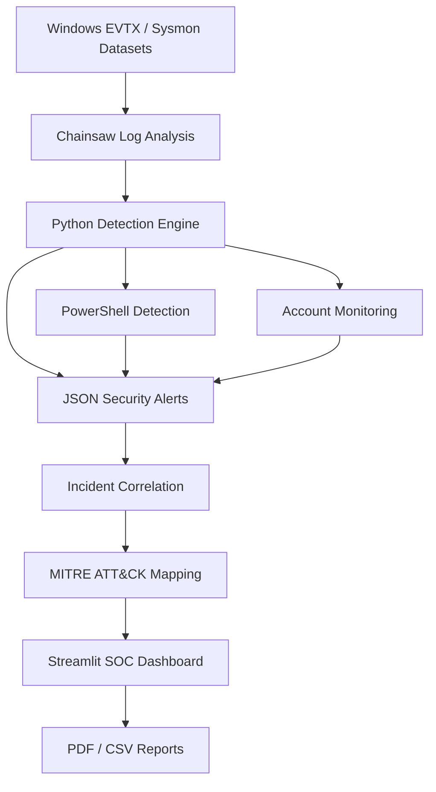

# 🛡️ KaliSOC – Windows Threat Hunting & Detection Platform

KaliSOC is a Python-based cybersecurity investigation platform developed and operated entirely on Kali Linux.

It analyzes Windows Event Log and Sysmon forensic datasets to identify suspicious activity, generate security alerts, correlate process events, map findings to MITRE ATT&CK, and produce PDF investigation reports.

## 🚀 Project Features

- Windows EVTX forensic log analysis using Chainsaw
- PowerShell threat detection
- Suspicious registry modification detection
- Windows account creation monitoring
- Process-based event correlation using Process GUIDs
- MITRE ATT&CK technique references
- Interactive Streamlit SOC dashboard
- Security severity and confidence classification
- Chronological investigation timeline
- CSV export
- Automated PDF incident reporting

## 🏗️ Project Architecture



## 🧰 Technology Stack

| Technology | Purpose |
|---|---|
| Kali Linux | Main operating system |
| Python 3 | Detection and automation |
| Chainsaw | Windows forensic log analysis |
| JSON | Alert storage |
| Pandas | Data processing |
| Streamlit | SOC dashboard |
| Plotly | Interactive visualizations |
| ReportLab | PDF report generation |
| MITRE ATT&CK | Technique references |

## 📂 Project Structure

```text
KaliSOC/
│
├── detection/
│   ├── detection_engine.py
│   ├── powershell_detector.py
│   ├── account_detector.py
│   └── report_generator.py
│
├── dashboard/
│   ├── app.py
│   └── app_v2.py
│
├── datasets/
├── output/
├── reports/
├── screenshots/
├── docs/
├── rules/
│
├── requirements.txt
├── .gitignore
└── README.md
```

## 🔍 Detection Capabilities

### 1. PowerShell Threat Detection

Identifies investigation indicators such as:

- Remote payload download
- Download-and-execute patterns
- Suspicious credential prompts
- Hidden PowerShell execution
- Encoded and compressed commands

### 2. Registry Modification Detection

Identifies modifications involving:

`__PSLockdownPolicy`

Uses Windows Sysmon Event ID 12 and generates investigation alerts.

### 3. Account Monitoring

Monitors Windows security events:

- Event ID 4720 – User account creation
- Event ID 4741 – Computer account creation

Identifies unusual account naming and records creator information.

### 4. Incident Correlation

Groups detection records using computer name and Process GUID when available.

### 5. MITRE ATT&CK

Includes candidate MITRE ATT&CK technique references associated with detection rules.

Mappings require analyst validation.

## 📊 SOC Dashboard

The Streamlit dashboard provides:

- Security overview and metrics
- Detection analytics
- Severity distribution
- Correlated event groups
- Security event timeline
- MITRE ATT&CK references
- Individual alert investigation
- CSV exports
- PDF investigation reports

## ⚙️ Installation

### Prerequisites

- Kali Linux
- Python 3
- Git
- Chainsaw

### 1. Update Kali Linux

```bash
sudo apt update
```

### 2. Install dependencies

```bash
sudo apt install -y git python3 python3-pip python3-venv chainsaw
```

### 3. Clone the repository

```bash
git clone https://github.com/YOUR_USERNAME/KaliSOC.git

cd KaliSOC
```

Replace `YOUR_USERNAME` with your GitHub username.

### 4. Create a virtual environment

```bash
python3 -m venv .venv

source .venv/bin/activate
```

### 5. Install Python libraries

```bash
pip install -r requirements.txt
```

### 6. Prepare directories

```bash
mkdir -p datasets output reports
```

### 7. Download forensic samples

```bash
git clone --depth 1 \
https://github.com/sbousseaden/EVTX-ATTACK-SAMPLES.git \
datasets/EVTX-ATTACK-SAMPLES
```

## ▶️ Running KaliSOC

Generate the required forensic JSON files using Chainsaw.

### PowerShell registry event

```bash
SAMPLE=$(find datasets/EVTX-ATTACK-SAMPLES \
-type f -iname '*powershell*clm*' -print -quit)

chainsaw dump "$SAMPLE" --json \
--output output/powershell-clm-events.json
```

### Process creation events

```bash
chainsaw search -t 'Event.System.EventID: =1' \
datasets/EVTX-ATTACK-SAMPLES \
--json \
--output output/process-creation-events.json
```

### Account creation events

```bash
chainsaw search -t 'Event.System.EventID: =4720' \
datasets/EVTX-ATTACK-SAMPLES \
--json \
--output output/account-creation-events.json
```

### Computer account events

```bash
chainsaw search -t 'Event.System.EventID: =4741' \
datasets/EVTX-ATTACK-SAMPLES \
--json \
--output output/computer-account-events.json
```

Run the detection engines:

```bash
python3 detection/detection_engine.py

python3 detection/powershell_detector.py

python3 detection/account_detector.py
```

### Launch the dashboard

```bash
streamlit run dashboard/app_v2.py
```

Open:

`http://localhost:8501`

## 📄 PDF Investigation Reports

Generate reports using:

```bash
python3 detection/report_generator.py
```

Generated reports are stored inside:

```text
reports/KaliSOC_Incident_Report.pdf
```

The dashboard also provides PDF generation and downloading.

## ⚠️ Project Scope and Limitations

KaliSOC currently performs offline analysis of historical Windows forensic logs.

It does not currently provide:

- Live Windows endpoint monitoring
- Real-time SIEM ingestion
- Active Directory administration
- Automated endpoint containment
- Automated remediation

Detection results are heuristic indicators and must be validated by a security analyst.

Dataset coverage varies. Some investigated event types may not have sufficient sample records to validate a detection rule.

## 🔐 Responsible Use

This project is intended for cybersecurity education, forensic investigation, threat hunting, and defensive security research.

Use authorized datasets and conduct testing only in environments where you have permission.

## 📚 References

- Chainsaw: https://github.com/WithSecureLabs/chainsaw
- EVTX Attack Samples: https://github.com/sbousseaden/EVTX-ATTACK-SAMPLES
- MITRE ATT&CK: https://attack.mitre.org/
- Streamlit: https://streamlit.io/
- Sigma: https://github.com/SigmaHQ/sigma

## 👨‍💻 Author

Developed as a cybersecurity portfolio project focused on:

- Blue Team Operations
- Windows Threat Hunting
- Digital Forensics
- Detection Engineering
- Security Monitoring


## 🧩 Sigma Detection Integration

KaliSOC integrates the Sigma rule format with Chainsaw to perform standardized Windows threat hunting.

### Features

- Official SigmaHQ detection rule integration.
- Custom YAML-based Sigma detection rules.
- Windows EVTX analysis using Chainsaw.
- Process creation and PowerShell detection.
- Sigma rule severity classification.
- MITRE ATT&CK technique references.
- JSON-based Sigma alert normalization.
- Sigma Detection Center in the Streamlit dashboard.
- Sigma findings included in PDF investigation reports.

### Sigma Technologies

| Tool | Purpose |
|---|---|
| SigmaHQ | Standardized detection rules |
| Chainsaw | Sigma-based Windows event hunting |
| YAML | Detection rule definitions |
| Python | Alert normalization |
| Streamlit | Sigma analytics dashboard |

### Custom Sigma Rule

Location:

```text
rules/custom/ksoc_hidden_powershell.yml
```

The custom rule detects PowerShell launched with hidden-window arguments.

### Run Sigma Hunting

```bash
chainsaw hunt \
datasets/EVTX-ATTACK-SAMPLES \
-s rules/custom \
-m .external/chainsaw-source/mappings/sigma-event-logs-all.yml \
--json -q --skip-errors \
> output/sigma-custom-hunt.json
```

### Run Official SigmaHQ Rules

```bash
chainsaw hunt \
datasets/EVTX-ATTACK-SAMPLES \
-s .external/sigma/rules/windows/process_creation \
-m .external/chainsaw-source/mappings/sigma-event-logs-all.yml \
--json -q --skip-errors \
> output/sigma-official-hunt.json
```

### Import Sigma Results

```bash
python3 detection/sigma_importer.py
```

Normalized results are stored in:

```text
output/sigma-alerts.json
```

### Dashboard Integration

The Sigma Detection Center displays:

- Total Sigma detection matches.
- Distinct Sigma rule IDs.
- Affected computers.
- Rule-wise analytics.
- Sigma severity distribution.
- Individual rule investigation.
- MITRE ATT&CK references.
- Downloadable CSV results.

### Sample Dataset Results

In the current EVTX dataset run:

| Detection source | Matches |
|---|---:|
| Official Sigma hunt | 612 |
| Custom Sigma rule test | 2 |

These are detection matches, not confirmed attacks or unique incidents. Every finding requires analyst validation.

**KaliSOC – Turning Windows Security Logs into Actionable Investigation Findings.**

